# GapFinder AI — Personalized Learning and Knowledge Gap Detection

GapFinder AI is a full-stack academic diagnostic web application designed to eliminate student revision blind spots. Instead of generic flashcards or ungrounded chatbots, GapFinder AI parses a student's actual syllabus, lecture notes, textbook chapters, and past question papers, generates grounded diagnostic examinations, deterministically diagnoses exact knowledge gaps, and constructs an adaptive, time-capped revision schedule.

---

## 1. System Architecture & Complete Workflow

```mermaid
flowchart TD
    subgraph Client ["Student Client (Next.js 15 App Router)"]
        UI_HOME["Landing Page & Auth"]
        UI_DASH["Student Dashboard"]
        UI_DOCS["Document Upload Hub"]
        UI_MAP["Curriculum Topic Map"]
        UI_QUIZ["Diagnostic Quiz Runner"]
        UI_GAP["Knowledge Gap Report (Core)"]
        UI_PLAN["Personalized Revision Schedule"]
        UI_RAG["Explain-This-Topic Assistant"]
        UI_PROG["Longitudinal Progress Tracking"]
    end

    subgraph Server_API ["Next.js Server Route Handlers"]
        API_DOC["/api/documents (PDF/TXT Parser)"]
        API_TOPIC["/api/topics (Curriculum Extractor)"]
        API_QUIZ["/api/quiz (RAG Question Generator)"]
        API_SUBMIT["/api/quiz/submit (Evaluator & Mastery Engine)"]
        API_GAP["/api/gap-report (Deterministic Diagnosis)"]
        API_PLAN["/api/revision-plan (Adaptive Planner)"]
        API_CHAT["/api/assistant (Cited RAG Chat)"]
    end

    subgraph AI_Engine ["AI & Vector Grounding Layer"]
        GEMINI["Google Gemini 1.5 Flash (Official Gen AI SDK)"]
        EMBED["text-embedding-004 (768 Dimensions)"]
        DEV_FALLBACK["Deterministic Dev Engine (Labeled Offline Mode)"]
    end

    subgraph Storage_Layer ["Database & Authentication"]
        SUPABASE_AUTH["Supabase Auth / Demo Session"]
        PG_VECTOR["PostgreSQL + pgvector (Cosine Similarity)"]
        LOCAL_STORE["Local Persistent JSON Store (data/app-store.json)"]
    end

    UI_DOCS --> API_DOC
    API_DOC --> GEMINI
    API_DOC --> EMBED
    API_DOC --> PG_VECTOR & LOCAL_STORE

    UI_QUIZ --> API_QUIZ
    API_QUIZ --> EMBED
    API_QUIZ --> GEMINI & DEV_FALLBACK

    UI_QUIZ --> API_SUBMIT
    API_SUBMIT --> API_GAP
    API_SUBMIT --> API_PLAN

    UI_RAG --> API_CHAT
    API_CHAT --> EMBED
    API_CHAT --> GEMINI & DEV_FALLBACK
```



---

## 2. Technology Stack

| Layer | Technologies |
|---|---|
| **Frontend** | Next.js 15 (App Router), React 19, TypeScript, Tailwind CSS, Lucide Icons |
| **Backend** | Next.js Route Handlers, Server-Side PDF & TXT Parser (`pdf-parse`) |
| **AI Integration** | Official Google Gen AI SDK (`@google/generative-ai`), Gemini 1.5 Flash, `text-embedding-004` |
| **Database & Auth** | Supabase PostgreSQL, `pgvector` vector extension, Supabase Auth |
| **Development Fallback** | Built-in offline development engine with deterministic question generation and persistent local store |
| **Deployment** | Vercel-ready serverless Next.js architecture |

---

## 3. The 12 Implemented Pages & Features

1. **Page 1: Landing Page (`/`)**
   - Brand headline: *"Discover What You Don't Know. Learn What Matters."*
   - Feature matrix, step-by-step workflow visualizer, benefits for students and educators, direct navigation.
2. **Page 2: Authentication (`/auth/login`, `/auth/register`)**
   - Supabase Auth registration and sign-in.
   - One-click instant **Demo Student Login** (`student@gapfinder.ai`) for rapid evaluator inspection.
3. **Page 3: Student Dashboard (`/dashboard`)**
   - Live metrics: Total Topics Assessed, Strong, Medium, Weak, Needs Assessment counts.
   - Latest quiz percentage, recommended next action, pending revision tasks checklist, recent attempts.
   - Helpful onboarding screen when starting a fresh workspace.
4. **Page 4: Study Workspaces (`/workspace`)**
   - Multi-subject management.
   - Target exam countdown and daily study budget (minutes).
5. **Page 5: Document Upload (`/workspace/[subjectId]/documents`)**
   - Three structured categories: Syllabus, Lecture Notes & Chapters, Previous Papers (PYQs).
   - Server-side text extraction, chunking, and vector embedding generation.
   - One-click **"Preload Sample Syllabus & Notes"** button for immediate evaluation.
6. **Page 6: Extracted Topic Map (`/workspace/[subjectId]/topic-map`)**
   - Units, topics, and subtopics extracted directly from the uploaded syllabus.
   - Topic editing, adding custom topics, and deleting topics.
7. **Page 7: Diagnostic Quiz (`/workspace/[subjectId]/quiz`)**
   - Multi-topic selection, question count (5, 10, 15), difficulty levels (Easy, Medium, Hard).
   - Questions generated strictly from retrieved chunks using RAG.
   - Correct answers and explanations hidden until submission.
8. **Page 8: Quiz Results (`/workspace/[subjectId]/quiz/[quizId]/results`)**
   - Score and accuracy percentage badges.
   - Topic-wise performance breakdown.
   - Question-by-question audit: student answer vs verified correct answer, detailed explanation, and exact source citations.
9. **Page 9: Knowledge Gap Report (`/workspace/[subjectId]/gap-report`) [PRIMARY FEATURE]**
   - Deterministic mathematical classification: Strong (≥80%), Medium (50–79%), Weak (<50%), Needs More Assessment (<3 attempts).
   - Mathematical evidence explanation for each diagnosis (consecutive misses, accuracy, question citations).
   - Trend tracking: Improving, Declining, Stable.
   - Clear academic disclaimer: indicators guide study prioritization, not formal intelligence scores.
10. **Page 10: Personalized Revision Plan (`/workspace/[subjectId]/revision-plan`)**
    - Day-by-day revision timeline respecting target exam date and daily study budget.
    - Heavily prioritizes weak topics (foundational review + re-quiz) while scheduling spaced retention checks for strong topics.
    - Dynamic re-scheduling: automatically adjusts tasks whenever new quiz scores update topic mastery.
    - Checkboxes to toggle tasks between completed and pending.
11. **Page 11: Explain-This-Topic Assistant (`/workspace/[subjectId]/assistant`)**
    - Grounded RAG assistant retrieving course chunks before formulating responses.
    - Exact document, page, and section citations.
    - Prompt suggestions pre-populated with student's detected weak topics.
12. **Page 12: Progress Tracking (`/workspace/[subjectId]/progress`)**
    - Historical quiz score progression timeline.
    - List of weak topics that have demonstrably improved over time.
    - Outstanding knowledge gaps still requiring attention.

---

## 4. Setup & Running Instructions

### Quick Start (Offline Development Mode)
1. Install dependencies:
   ```bash
   npm install
   ```
2. Build the project:
   ```bash
   npm run build
   ```
3. Run the development server:
   ```bash
   npm run dev
   ```
4. Open [http://localhost:3000](http://localhost:3000) in your browser.
5. Click **"Get Started"** or **"Log In"** -> click **"Instant Demo Student Access"**.
6. Navigate to **"Study Workspaces"** -> Open the workspace -> Click **"Preload Sample Syllabus & Notes"** in the Documents tab -> Take a diagnostic quiz to experience the entire closed-loop diagnostic cycle!

### Production Cloud Mode (Supabase + Google Gemini)
1. Copy `.env.local.example` to `.env.local`:
   ```bash
   cp .env.local.example .env.local
   ```
2. Populate the environment variables:
   - `GEMINI_API_KEY`: Get a free key at [Google AI Studio](https://aistudio.google.com/app/apikey).
   - `NEXT_PUBLIC_SUPABASE_URL` and `NEXT_PUBLIC_SUPABASE_ANON_KEY`: Get from [Supabase](https://supabase.com).
3. Execute the SQL schema in your Supabase SQL editor:
   - Run the script in `supabase/schema.sql` to enable `pgvector` and configure all tables and RLS policies.
4. Run `npm run build` and deploy to Vercel or start the production server with `npm run start`.
