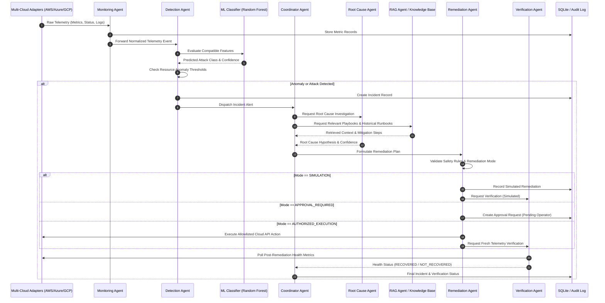
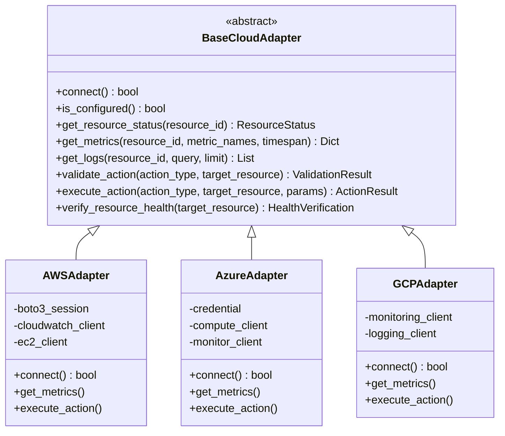
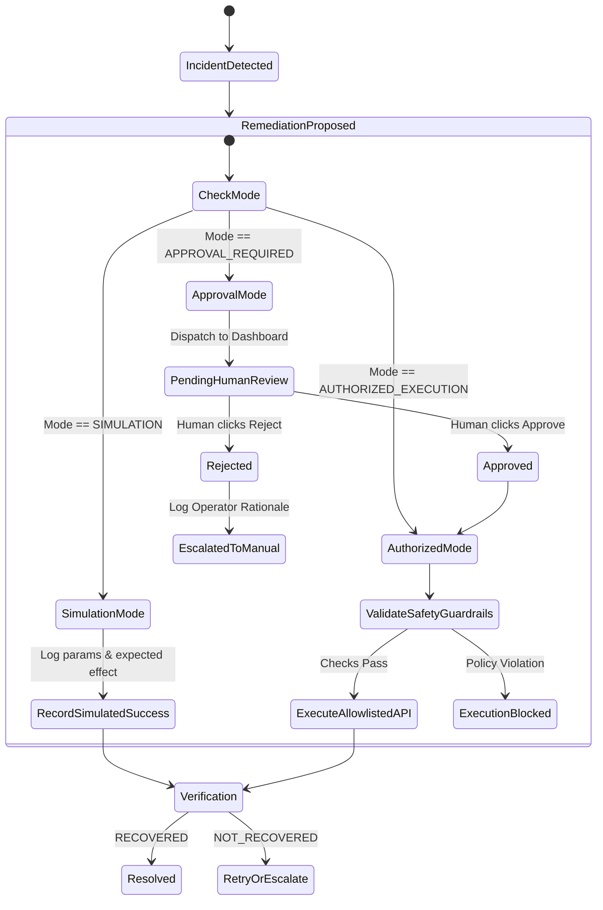
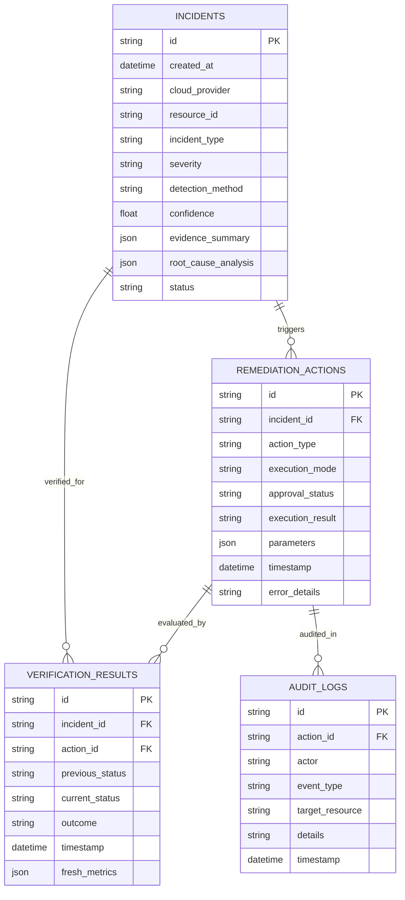

# Technical Architecture & Project Documentation

## Self-Healing Cloud Infrastructure Using Multi-Agent AI for Autonomous Remediation

---

## 1. Executive Summary

This document specifies the technical architecture, data flow, agent interaction protocols, cloud adapter abstraction, machine learning pipelines, and safety governance model for the **Self-Healing Cloud Infrastructure** platform.

The system is designed to provide autonomous detection, root-cause investigation, and controlled remediation across multi-cloud environments (AWS, Azure, Google Cloud Platform) with rigorous verification and human-in-the-loop governance.

---

## 2. Multi-Agent System Architecture

The core of the system is built upon a decentralized, specialized **Multi-Agent Architecture**:

### Agent Roles & Specifications

| Agent | Primary Responsibility | Input Schema | Output Schema | Fallback Strategy |
|---|---|---|---|---|
| **Monitoring Agent** | Collects metrics & health across clouds at configured intervals | Cloud Provider ID, Resource IDs | `NormalizedTelemetryEvent` | Marks provider `UNAVAILABLE` or `NOT CONFIGURED`; does not fabricate values |
| **Detection Agent** | Identifies anomalies via ML classifier and configurable thresholds | `NormalizedTelemetryEvent` | `DetectionResult` (Class, Confidence, Severity) | If features incompatible with ML model, returns `UNKNOWN` or applies deterministic threshold logic |
| **Coordinator Agent** | Orchestrates incident lifecycle and dispatches tasks to agents | `IncidentAlert` | `IncidentResolutionWorkflow` | Enforces max retries (3); halts on repeated failures |
| **Root Cause Agent** | Analyzes telemetry, logs, and historical context | Evidence Bundle (telemetry + detection) | `RootCauseAnalysis` | Deterministic rule-based causal analysis if LLM API is unset |
| **RAG Agent** | Searches troubleshooting runbooks & past incident resolutions | Query / Incident Symptom | `RetrievedPlaybook[]` | TF-IDF / keyword similarity fallback if embeddings unavailable |
| **Remediation Agent** | Formulates recovery plan and enforces execution guardrails | Incident + RCA + Playbook | `RemediationActionPlan` | Default to `SIMULATION`; strictly reject non-allowlisted actions |
| **Verification Agent** | Polls fresh telemetry post-remediation to confirm recovery | Incident ID, Action ID, Target Resource | `VerificationOutcome` | Marks `VERIFICATION_FAILED` if metrics do not normalize after grace period |

---

## 3. Machine Learning Pipeline & Dataset Mapping

### Public Datasets Employed

1. **CIC-IDS2017**:
   - Source: Canadian Institute for Cybersecurity, University of New Brunswick.
   - Attack categories extracted: DDoS, Brute Force (SSH/FTP), Web Attacks (SQLi where verified labels exist), Normal flows.
   - Raw format: 80+ network flow features (Flow Duration, Total Fwd Packets, Packet Length Mean, Flow Bytes/s, Flag counts).

2. **ADFA-LD**:
   - Source: University of New South Wales, Canberra.
   - Attack categories extracted: Adduser (Privilege Escalation), Normal host system-call traces.
   - Feature engineering: System-call frequency histograms and n-gram transitional frequencies.

### Target Classification Schema (5 Classes)
- **Class 0: `NORMAL`**
- **Class 1: `DDOS`**
- **Class 2: `BRUTE_FORCE`**
- **Class 3: `SQL_INJECTION`**
- **Class 4: `PRIVILEGE_ESCALATION`**

### Preprocessing & Defense Against Data Leakage
- Column names sanitized: stripped whitespace, lowercased, special characters replaced with underscores.
- Duplicate flow records removed to prevent identical flows appearing in both train and test partitions.
- Infinite values (`np.inf`, `-np.inf`) converted to NaN and imputed using median statistics from training splits.
- Stratified 80/20 train/test split preserving class distribution.
- Preprocessing scaler (`StandardScaler` or `RobustScaler`) fitted **only** on the training split.

---

## 4. Multi-Cloud Adapter Architecture

All cloud provider integrations inherit from a unified abstract base class:

### Supported Remediation Operations Allowlist

| Action Identifier | AWS API Equivalent | Azure API Equivalent | GCP API Equivalent | Risk Level |
|---|---|---|---|---|
| `RESTART_SERVICE` | SSM RunCommand (`systemctl restart`) | Azure RunCommand | Compute OS Config | Low |
| `SCALE_UP` | AutoScaling UpdateDesiredCapacity | VM ScaleSet ManualScale | Managed Instance Group Resize | Medium |
| `RATE_LIMIT_IP` | AWS WAF IPSet Update | Azure Front Door / WAF Rule | Cloud Armor Security Policy | Medium |
| `QUARANTINE_INSTANCE` | Security Group Isolation | NSG Lockdown Rule | VPC Firewall Deny Rule | High (Requires Approval) |

*Destructive operations such as instance termination (`TerminateInstances`, `DeleteVirtualMachine`) are strictly disabled and rejected by policy.*

---

## 5. Governance & Remediation Modes

---

## 6. Database Relational Schema

The underlying database uses SQLite (via SQLAlchemy) for portability and zero-configuration execution:

